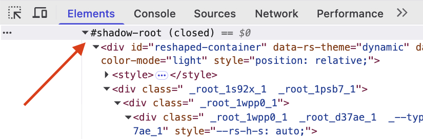
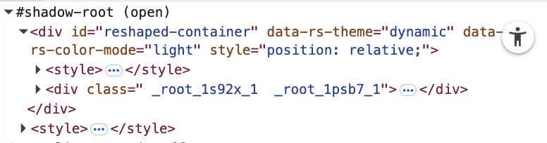

## The Problem: Closed Shadow DOM

When testing iFrames with Playwright (which, unlike Cypress, has excellent iframe support), you may encounter a particularly tricky scenario: the **closed Shadow DOM**. In your browser's DevTools, it looks like this:



Notice the `#shadow-root (closed)` label.

A common place to hit this combination is embedded third-party widgets (payment fields, identity-verification flows) that render inside an iframe and keep their internals in a closed shadow root.

## Why Shadow DOM is Closed

The Shadow DOM provides encapsulation for web components, isolating their internal structure from the rest of the page. When a Shadow DOM is set to `closed` mode, it's mostly about encapsulation:

- Isolation: makes it harder for page scripts to reach into or tamper with the component's internals. It's a deterrent rather than a security boundary: any script that runs first can patch `attachShadow`, which is exactly what the trick below does.
- Encapsulation: ensures component internals remain private and protected from outside interference
- API contract: forces interaction through the component's public API only

While these are valid architectural decisions, they create a challenge for automated testing where you need to verify the component's internal state.

## The Testing Challenge

When you try to use Playwright to interact with elements inside a closed Shadow DOM, you'll encounter errors because Playwright cannot pierce through the closed boundary. The DOM query simply fails to find the elements you're looking for.

For most test engineers, this seems like game over. However, there's a clever workaround.

## The Solution: Force Open Shadow DOM

You can intercept the Shadow DOM creation at the browser level and force all Shadow DOMs to be created in `open` mode instead:



Notice the difference: `#shadow-root (open)` allows Playwright to access the internal elements.

## Implementation

This is the function that does it:

```typescript
async function forceOpenShadowDOM(page: Page) {
  await page.addInitScript(() => {
    const orig = Element.prototype.attachShadow
    Element.prototype.attachShadow = function (init) {
      // Force mode: 'open' even if the component requests 'closed'
      return orig.call(this, { ...init, mode: "open" })
    }
  })
}
```

This function uses Playwright's `addInitScript()` to inject JavaScript that runs before any page scripts load. It:

1. Saves the original `attachShadow` method
2. Overrides `Element.prototype.attachShadow`
3. Intercepts all Shadow DOM creation calls
4. Forces the mode to `'open'` regardless of what the component requests
5. Keeps all other initialization options

## Usage in Tests

Add this to your test setup to apply it to all tests:

```typescript
test.beforeEach(async ({ page }) => {
  await forceOpenShadowDOM(page)
  // Your test setup continues...
})
```

Alternatively, for specific tests:

```typescript
test("should interact with shadow DOM elements", async ({ page }) => {
  await forceOpenShadowDOM(page)
  await page.goto("https://your-app.com")

  // Now you can access shadow DOM elements normally
  await page.locator("#shadow-host").locator("button").click()
})
```

## Inside an iframe

`addInitScript()` runs in child frames as well as the top-level page. Playwright evaluates it whenever a child frame is attached or navigated, in the context of that frame, so one call covers the iframe too. Combine it with `frameLocator()`:

```typescript
test("should fill a field inside a closed shadow root in an iframe", async ({ page }) => {
  await forceOpenShadowDOM(page) // also runs in every child frame
  await page.goto("https://your-app.com/checkout")

  const widget = page.frameLocator('iframe[title="Payment"]')

  // Playwright locators pierce open shadow roots, so no special selectors needed
  await widget.getByLabel("Cardholder name").fill("Test User")
  await expect(widget.getByRole("button", { name: "Pay" })).toBeEnabled()
})
```

## Important Considerations

- Test environment only: this technique should only be used in testing environments. It fundamentally changes how the application behaves.
- Timing matters: call `forceOpenShadowDOM()` before navigating to your page, as it needs to inject the script before the page loads.
- iFrame support: this works within iFrames as well, which is what you need for embedded components.
- Declarative Shadow DOM isn't covered: a shadow root declared in HTML with `<template shadowrootmode="closed">` is created by the HTML parser, not by calling `attachShadow()`, so this override never sees it and the root stays closed.

<figure class="diagram">
<svg viewBox="0 0 720 290" role="img" aria-label="Two swim-lanes on the same timeline. Lane 1: addInitScript wraps attachShadow, then goto loads the page scripts, the component asks for a closed root, gets an open one, and the locator passes. Lane 2: there is no init script when goto loads the page, so the component gets a real closed root; addInitScript is added afterwards and only runs on the next navigation, so the locator fails.">
  <text class="d-edge" x="16" y="26">LANE 1 · addInitScript() before goto()</text>
  <rect class="d-panel" x="8" y="34" width="704" height="78" rx="6"/>
  <rect class="d-box-green" x="16" y="46" width="136" height="54" rx="5"/>
  <text class="d-text" x="84" y="70" text-anchor="middle">addInitScript()</text>
  <text class="d-text-sm" x="84" y="87" text-anchor="middle">wraps attachShadow</text>
  <path class="d-line" d="M152,73 L168,73"/>
  <path class="d-arrow" d="M176,73 l-8,-4 l0,8 z"/>
  <rect class="d-box" x="176" y="46" width="136" height="54" rx="5"/>
  <text class="d-text" x="244" y="70" text-anchor="middle">goto()</text>
  <text class="d-text-sm" x="244" y="87" text-anchor="middle">page scripts load</text>
  <path class="d-line" d="M312,73 L328,73"/>
  <path class="d-arrow" d="M336,73 l-8,-4 l0,8 z"/>
  <rect class="d-box" x="336" y="46" width="136" height="54" rx="5"/>
  <text class="d-text" x="404" y="70" text-anchor="middle">component asks</text>
  <text class="d-text-sm" x="404" y="87" text-anchor="middle">for mode: "closed"</text>
  <path class="d-line" d="M472,73 L488,73"/>
  <path class="d-arrow" d="M496,73 l-8,-4 l0,8 z"/>
  <rect class="d-box-green" x="496" y="46" width="136" height="54" rx="5"/>
  <text class="d-text" x="564" y="70" text-anchor="middle">root is open</text>
  <text class="d-text-sm" x="564" y="87" text-anchor="middle">despite the request</text>
  <path class="d-line" d="M632,73 L646,73"/>
  <path class="d-arrow" d="M654,73 l-8,-4 l0,8 z"/>
  <circle class="d-node-green" cx="684" cy="73" r="22"/>
  <text class="d-on-fill" x="684" y="77" text-anchor="middle">PASS</text>
  <text class="d-edge" x="16" y="152">LANE 2 · addInitScript() after goto()</text>
  <rect class="d-panel" x="8" y="160" width="704" height="78" rx="6"/>
  <rect class="d-panel" x="16" y="172" width="136" height="54" rx="5" stroke-dasharray="4 4"/>
  <text class="d-text-sm" x="84" y="203" text-anchor="middle">no init script yet</text>
  <rect class="d-box" x="176" y="172" width="136" height="54" rx="5"/>
  <text class="d-text" x="244" y="196" text-anchor="middle">goto()</text>
  <text class="d-text-sm" x="244" y="213" text-anchor="middle">page scripts load</text>
  <path class="d-line" d="M312,199 L328,199"/>
  <path class="d-arrow" d="M336,199 l-8,-4 l0,8 z"/>
  <rect class="d-box-red" x="336" y="172" width="136" height="54" rx="5"/>
  <text class="d-text" x="404" y="196" text-anchor="middle">root is closed</text>
  <text class="d-text-sm" x="404" y="213" text-anchor="middle">as requested</text>
  <path class="d-line" d="M472,199 L488,199"/>
  <path class="d-arrow" d="M496,199 l-8,-4 l0,8 z"/>
  <rect class="d-box-amber" x="496" y="172" width="136" height="54" rx="5"/>
  <text class="d-text" x="564" y="196" text-anchor="middle">addInitScript()</text>
  <text class="d-text-sm" x="564" y="213" text-anchor="middle">runs on next load</text>
  <path class="d-line" d="M632,199 L646,199"/>
  <path class="d-arrow" d="M654,199 l-8,-4 l0,8 z"/>
  <circle class="d-node-red" cx="684" cy="199" r="22"/>
  <text class="d-on-fill" x="684" y="203" text-anchor="middle">FAIL</text>
  <path class="d-line" d="M16,268 L640,268"/>
  <path class="d-arrow" d="M648,268 l-8,-4 l0,8 z"/>
  <text class="d-text-sm" x="684" y="272" text-anchor="middle">time</text>
</svg>
<figcaption>Same component, same test, different order. The override only works if it's in place before the page's own scripts run, so call it before <code>goto()</code>.</figcaption>
</figure>

This approach gives you the testing capability you need while respecting that closed Shadow DOM serves legitimate purposes in production code.
